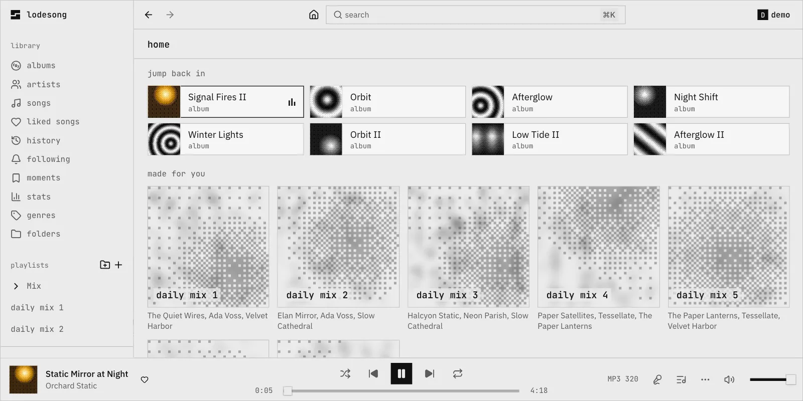
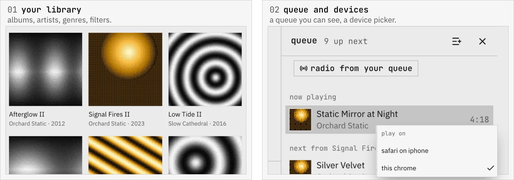
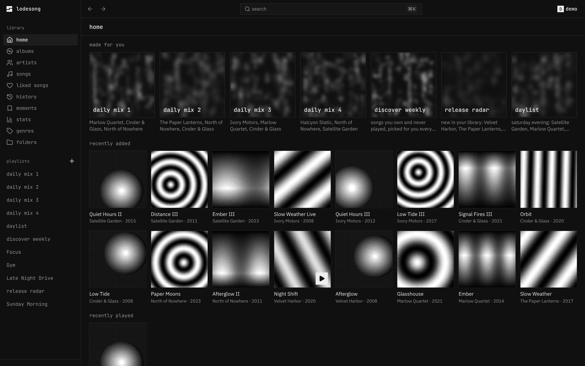
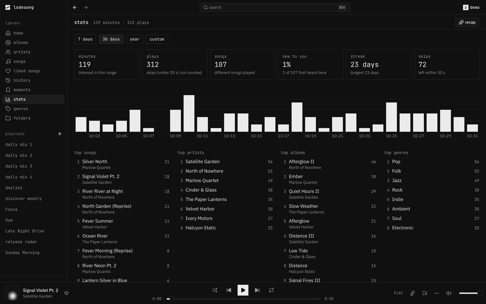
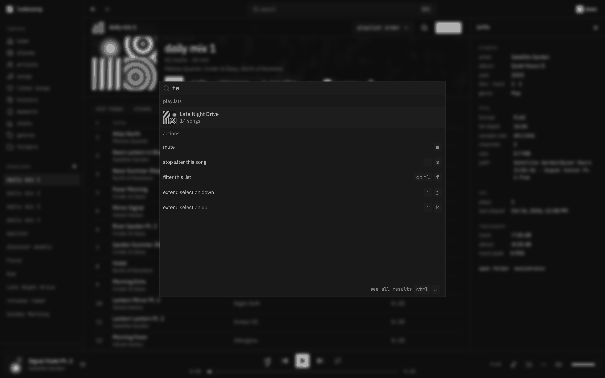
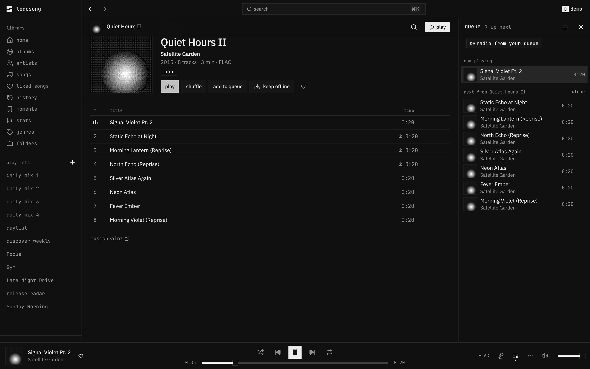
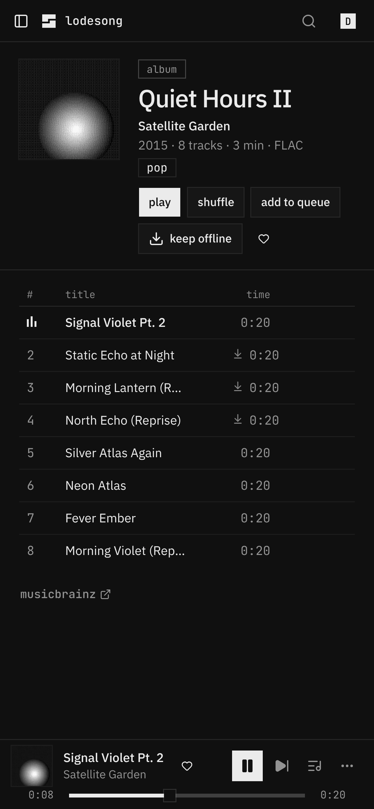

<p align="center">
  <picture>
    <source media="(prefers-color-scheme: dark)" srcset="docs/hero-dark.webp">
    
  </picture>
</p>

<p align="center">
  <a href="https://github.com/FindMalek/lodesong/actions/workflows/ci.yml"></a>
  <a href="https://github.com/FindMalek/lodesong/releases"></a>
  <a href="https://github.com/FindMalek/lodesong/pkgs/container/lodesong"></a>
  <a href="LICENSE"></a>
</p>

<p align="center">
  A monochrome web player for your <a href="https://www.navidrome.org">Navidrome</a> library.<br>
  Square covers, hairline borders, synced lyrics, a queue you can see, mixes made from what you play,
  and one session across all your devices.
</p>

<p align="center">
  <a href="#run-it">Run it</a> ·
  <a href="#why">Why</a> ·
  <a href="#features">Features</a> ·
  <a href="#works-with">Works with</a> ·
  <a href="#docs">Docs</a> ·
  <a href="#faq">FAQ</a> ·
  <a href="#develop">Develop</a>
</p>

**Try it without your own music:** `bun run demo:library ./demo-music` generates a copyright-free library and
[`compose.demo.yaml`](compose.demo.yaml) serves it from a Navidrome ([demo library](docs/demo-library.md)). A hosted
[public demo](docs/public-demo.md) (sign in with `demo` / `demo`) is built and waits for its host.

## Run it

<a id="self-host"></a>

You need a running Navidrome and Docker (or [Bun](https://bun.sh) to build it yourself). Pick one.

**1. Docker compose**, next to your Navidrome:

```yaml
# compose.yaml
services:
  player:
    image: ghcr.io/findmalek/lodesong:latest   # amd64
    restart: unless-stopped
    environment:
      NAVIDROME_URL: http://navidrome:4533        # as this container reaches Navidrome
    ports:
      - "8080:8080"
    volumes:
      - player-data:/data
volumes:
  player-data:
```

```sh
docker compose up -d
```

**2. Docker run**, one container:

```sh
docker run -d --name lodesong --restart unless-stopped -p 8080:8080 \
  --add-host host.docker.internal:host-gateway \
  -e NAVIDROME_URL=http://host.docker.internal:4533 \
  -v lodesong-data:/data \
  ghcr.io/findmalek/lodesong:latest
```

**3. From source**, one executable:

```sh
git clone https://github.com/FindMalek/lodesong && cd lodesong
bun install && bun run build
NAVIDROME_URL=http://localhost:4533 ./dist/lodesong
```

Then open `http://localhost:8080` and sign in with your Navidrome account. No Navidrome yet?
[`docs/deploy/full-stack.compose.yaml`](docs/deploy/full-stack.compose.yaml) runs both.

The whole stack (Navidrome, lodesong, uploads into a tagging inbox, AI playlists, a domain with HTTPS, Lyterion) is
in **[self-hosting](docs/self-hosting.md)**, written so a person or a coding agent can follow it step by step. Every
setting is in [configuration](docs/configuration.md).

<details>
<summary>With a coding agent</summary>

Paste this into Claude Code, OpenCode, Codex or Cursor on the machine that will run it:

```text
Set up lodesong (https://github.com/FindMalek/lodesong) on this machine by following
docs/self-hosting.md in that repo, top to bottom. Ask me before each choice the guide marks as
"ask", never print secrets, and finish with the guide's "check it works" list, showing me each result.
```

The guide has a decision list up front (fresh Navidrome or existing, domain or local, which extras), commands with the
output to expect, and a closing checklist, so the agent can tell you what it did and what to look at.

</details>

## Why

Your own music deserves a player as good as the streaming apps, and better where they cut corners:

| | lodesong | Spotify web player |
|---|---|---|
| your files, your server | ✓ | — |
| daily mixes, discover weekly, a daylist, made from **your** library | ✓ | ✓ (their catalog) |
| a playlist from a sentence ("rainy sunday, slow, warm"), only songs you own | ✓ | ✓ (their catalog) |
| one session across devices: play here, control from there | ✓ | ✓ (Connect) |
| search by a half-remembered lyric, and play **from that line** | ✓ | exact words only, from the start |
| lyrics timing you can nudge per song, saved across devices | ✓ | — |
| next songs downloaded ahead, playing offline in the browser | ✓ | — |
| now playing and play/pause in your terminal (Claude Code, OpenCode) | ✓ | — |

It reads through Navidrome's API and never touches your files. Likes, ratings, playlists and plays stay Navidrome's, so
every other app agrees with it.

## Features

<p align="center">
  <picture>
    <source media="(prefers-color-scheme: dark)" srcset="docs/features-dark.webp">
    
  </picture>
</p>

**Listen**

- **Lyrics** for nearly every song: Navidrome's, else LRCLIB's, cached and fetched ahead. Word by word, full screen
  with `⇧F`, `[` `]` fix the timing per song. [lyrics](docs/lyrics.md)
- **Playback** that doesn't stutter: two decks for gapless handover, ReplayGain, the next songs precached by a service
  worker (instant seeks, plays offline), stalls recovered in place, crossfade and a ten-band equalizer.
- **Stream quality** per device: *auto* plays songs kept offline as they are and streams the rest as Opus 192, or
  pick original, mp3 320, Opus 192 or Opus 96. [devices](docs/devices.md#stream-quality)
- **Queue** you can see and steer: your queue apart from the album it came from, balanced shuffle, undo, stop after
  this song, sleep timer.

**Discover** · [mixes](docs/mixes.md)

- **Made for you** on home: daily mixes grouped by the artists you play together, **discover weekly** every Friday
  (songs you own and never played), and a **daylist** that changes four times a day. All saved as Navidrome playlists,
  so your phone has them too.
- **Playlists from a prompt**: "late night drive, 90s, no vocals" → Groq picks artists from your library, the server
  builds the list from songs you own. Review it, make it again, save.
- **Playlist folders**: make, nest (4 deep), rename and delete folders, drag playlists in and out, give a folder a picture
  or keep its generated aura. Folders live in lodesong, so playlist names in Navidrome never change.
- **Recap**: your month or year as a reel: minutes, top artists and songs, your listening hours, your biggest day,
  and your top songs played back or saved.
- **Stats**, history, forgotten favourites, and a radio that learns what you skip. Radio opens as a page.
- **Following**: the artists you play most are followed for you, you can follow, pin or unfollow others, and their new
  albums, EPs and singles land on a page grouped by week. With Lyterion your Spotify follows come over too.
  [new from artists you follow](docs/mixes.md#new-from-artists-you-follow)

**Everywhere** · [devices](docs/devices.md)

- **One session across devices**, like Spotify Connect: start on one tab or computer, control it from another, move
  playback with the device picker in the player bar.
- **Your phone**: the queue hands off both ways with Arpeggi; likes, ratings, playlists and plays are the server's, so
  every app agrees. [sync](docs/sync.md)
- **A Mac app** with the song around the notch: cover and bars while it plays, controls on hover, lyrics and the
  queue on click. [macOS](apps/macos/README.md)
- **Phone and desktop apps**: an [iPhone app](docs/ios.md) (sideload with a free Apple ID, or an AltStore source), an
  [Android app](docs/android.md) (an APK from the releases) and a [Linux and Windows app](docs/desktop.md). Each is a
  small shell around the same page, with media controls and playback in the background.
- **Scrobbling** through Navidrome (Last.fm, ListenBrainz): settings say whether it is on for you and how many plays
  were sent today.
- **Now playing in your terminal**: the song, its lyric line and ⏮ ⏸ ⏭ above the prompt in Claude Code and OpenCode.
- **Listen together** with friends on the same server. [listen together](docs/listen-together.md)

**Your library**

- **Search** (`⌘K`): songs, albums, artists, playlists, lyrics and commands, typo-tolerant, with filters
  (`artist:` `year:1990..1999` `is:liked` `format:flac` …). [search](docs/search.md)
- **Upload** songs or whole album folders from the browser into your tagging inbox (beets, Lyterion).
- **Library doctor**: missing covers, tags and ReplayGain, duplicates, low-quality files, with one-click fixes through
  Lyterion.
- **Keyboard first**: everything has a key, `?` shows them all, lists move with `j`/`k`. [shortcuts](docs/shortcuts.md)
- **Fast**: a 10k-song list renders ~40 rows, the library is cached so a reload paints instantly, the first screen is
  under 161 KB of JS (gzip).

<details>
<summary>More screenshots</summary>

<table>
  <tr>
    <td width="50%"></td>
    <td width="50%"></td>
  </tr>
  <tr>
    <td><sub><b>home</b>: recently added, rediscover, most played</sub></td>
    <td><sub><b>stats</b>: minutes, streaks, top lists, a listening clock</sub></td>
  </tr>
  <tr>
    <td></td>
    <td></td>
  </tr>
  <tr>
    <td><sub><b>search</b> (<code>⌘K</code>): songs, albums, artists, lyrics, commands</sub></td>
    <td><sub><b>queue</b>: yours, apart from the album it came from</sub></td>
  </tr>
</table>

<p align="center"></p>

</details>

The hero and feature images are captured from the built app over generated data: synthesized tracks, generated dithered
covers, no real music. `bun run hero` makes them again. The other screenshots are the
[demo library](docs/demo-library.md).

## Works with

Desktop browsers from the last two years. CI signs in and plays in **Chromium** (the whole suite) and **WebKit** (the
engine of Safari) on every pull request.

| | Chrome, Edge, Arc, Brave | Safari | Firefox |
|---|---|---|---|
| the player (playback, lyrics, offline, mixes, devices…) | ✓ | ✓ | ✓ (not in CI) |
| mini player that stays on top | ✓ | — | — |
| pick the output device (speakers, headphones) | ✓ | — | ✓ |
| install as an app | ✓ | ✓ (File → Add to Dock) | — |

**Phones**: the layout works down to 320 px, and there are [iPhone](docs/ios.md) and [Android](docs/android.md) apps.
Subsonic apps (Arpeggi, Substreamer, Symfonium) talk to the same Navidrome and account, so likes, ratings, playlists and
plays agree; the queue hands off with Arpeggi. [sync](docs/sync.md)

**Servers**: built and tested against [Navidrome](https://www.navidrome.org). Other OpenSubsonic servers should work,
untested.

**With [Lyterion](https://github.com/FindMalek/lyterion)**: it brings a Spotify library over to your own Navidrome.
lodesong connects to it: the import page shows each Spotify playlist and how much of it is already in your library, the
doctor's "fix with Lyterion" hands songs over for a better copy, and Lyterion keeps every playlist editable in
Navidrome. [lyterion](docs/lyterion.md)

## Docs

| | |
|---|---|
| [start to finish](docs/start-to-finish.md) | the whole route: stack, address, music, Lyterion, every device |
| [self-hosting](docs/self-hosting.md) | the whole stack, step by step, agent-friendly |
| [getting started](docs/getting-started.md) | run it next to Navidrome, sign in, first run |
| [configuration](docs/configuration.md) | every setting (generated from the code) |
| [deploy](docs/deploy/README.md) | Traefik, Caddy, nginx, Dokploy, image tags, health |
| [devices](docs/devices.md) · [sync](docs/sync.md) · [listen together](docs/listen-together.md) | one session, your phone, friends |
| [iPhone](docs/ios.md) · [Android](docs/android.md) · [Linux and Windows](docs/desktop.md) | the apps |
| [mixes](docs/mixes.md) · [search](docs/search.md) · [lyrics](docs/lyrics.md) · [shortcuts](docs/shortcuts.md) | how they work |
| [genres](docs/genres.md) · [lyterion](docs/lyterion.md) · [spotify import](docs/spotify-import.md) | bringing a Spotify library over |
| [API](docs/api.md) | the typed API, its reference at `/api`, tokens for your own integrations |
| [architecture](docs/architecture.md) · [security](docs/security.md) | how it's built, what's protected |
| [demo library](docs/demo-library.md) · [previews](docs/previews.md) · [public demo](docs/public-demo.md) | the generated library, per-PR previews, the permanent demo |
| [troubleshooting](docs/troubleshooting.md) | when something's off |
| [contributing](CONTRIBUTING.md) · [roadmap](docs/ROADMAP.md) | working on it |

## FAQ

**Does it work on a phone?** Yes: the layout follows the window down to 320 px, and it installs as an app from the
browser's menu. There are also an [iPhone app](docs/ios.md) you can sideload with a free Apple ID (music keeps playing
with the screen locked) and an [Android app](docs/android.md) (an APK from the releases). A Subsonic app (Arpeggi,
Substreamer, Symfonium…) works too.

**Can I try it without my own music?** Yes: `bun run demo:library ./demo-music` generates a library and
[`compose.demo.yaml`](compose.demo.yaml) serves it from a Navidrome. See [demo library](docs/demo-library.md).

**Does it change my music files?** No. It reads through Navidrome's API. Likes, ratings, playlists and plays are
stored by Navidrome; lodesong keeps only its own data (sessions, its search and lyrics cache, history) in `/data`.

**Does it phone home?** No. It talks to your Navidrome and, for missing lyrics, to LRCLIB (`LRCLIB_URL=` turns that
off). Groq is called only for playlists from a prompt, and only when you set `GROQ_API_KEY`; it gets your artist names,
never your files. The release check is off unless you set `UPDATE_CHECK=on`.

**Several Navidrome servers?** `NAVIDROME_SERVERS=home=http://a:4533,friend=https://b` and pick at sign-in.

**Other Subsonic servers?** Anything that speaks OpenSubsonic should work; it's tested against Navidrome.

## Develop

A Bun workspace driven by Turbo: `apps/player` (the React app), `apps/api` (the Bun server that serves it and proxies
Navidrome), `apps/macos` (the Mac app), `packages/ui` (the shared shadcn components), `packages/shared` (types both sides
use) and `packages/config` (the shared tsconfig). `typecheck` and `test` run per package and are cached.

```sh
bun install
bun run mock                                       # fake Navidrome on :4599 with 10k songs (demo / demo)
NAVIDROME_URL=http://127.0.0.1:4599 bun run dev    # app on :8080, hot reload
bun run check                                      # typecheck, lint, unit tests, bundle size, generated docs
bun run e2e                                        # Playwright against the mock
bun run demo:library ./demo-music                  # a real, copyright-free library for a real Navidrome
bun run hero                                       # the README hero and feature images, in docs/
```

Every pull request gets a [preview deployment](docs/previews.md) with a demo account. More in
[CONTRIBUTING](CONTRIBUTING.md).

## Credits

Built on [Navidrome](https://www.navidrome.org), [Bun](https://bun.sh), [React](https://react.dev),
[shadcn/ui](https://ui.shadcn.com) (on [Base UI](https://base-ui.com)) and [LRCLIB](https://lrclib.net). The demo
library's tracks are generated by this repository; there is no third-party music in it.

## License

MIT. The executable embeds satori, resvg-wasm and two OFL fonts: see [THIRD-PARTY-NOTICES.md](THIRD-PARTY-NOTICES.md).
