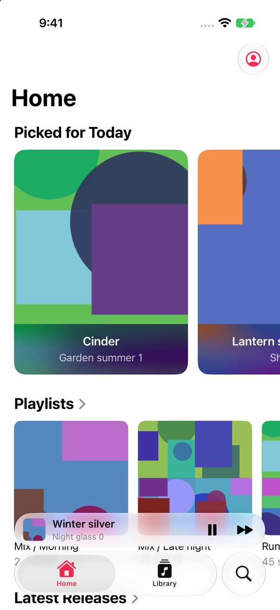
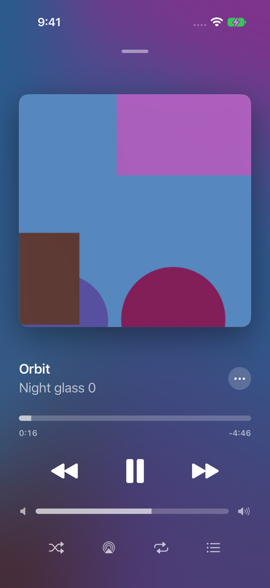
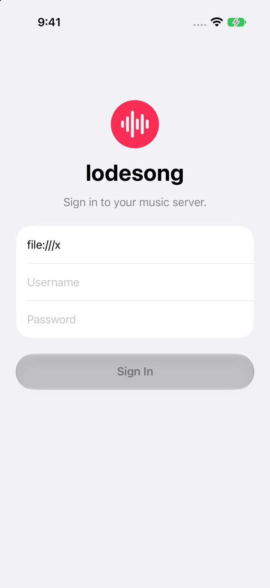

# lodesong on iPhone

A native SwiftUI app (`apps/ios`, iOS 26 or newer) that talks to your lodesong server: your library stored on the
phone, playback with the screen locked, and playlists you can keep downloaded.

| Home | Album | Now playing | Library |
|---|---|---|---|
|  |  |  |  |

Installing it is free. You don't need the paid Apple developer account (99 USD a year) and there is nothing to set up
in the App Store: a tool called [SideStore](https://sidestore.io) signs the app with your own free Apple ID.

## What you need

- an iPhone on iOS 26 or newer
- a computer (Mac, Windows or Linux) with a cable, for the first setup
- a free Apple ID. The setup tool is third party and asks for the password, so a spare Apple ID is a good idea.
  **Use that same Apple ID every time** you install, refresh or recover: another one installs a second, empty copy
- on Windows, iTunes; on Linux, `usbmuxd`
- Wi-Fi on the phone while installing and refreshing
- a running lodesong your phone can reach, ideally on HTTPS ([self-hosting](self-hosting.md))

## Install, step by step

**The native app is in releases from 1.23.0.** Until that is out, the source in step 9 installs the earlier web view app.
The steps follow [SideStore's own guide](https://docs.sidestore.io/docs/installation/install); check it if a screen
looks different.

1. On the iPhone, get **LocalDevVPN** from the App Store, open it, tap **Connect** and allow the VPN. SideStore needs it
   on every time it installs or refreshes.
2. On the computer, install [iloader](https://github.com/nab138/iloader/releases/latest).
3. Plug the phone in, unlock it and tap **Trust**.
4. In iloader, sign in with the Apple ID, pick the phone and choose **Install SideStore (Stable)**.
5. In iloader, open **Manage Pairing File** and press **Place** next to SideStore.
6. On the iPhone: Settings → General → **VPN & Device Management** → your Apple ID → **Trust**, then **Allow & Restart** if it asks.
7. Settings → Privacy & Security → **Developer Mode** → on. The phone restarts.
8. With LocalDevVPN connected, open SideStore, sign in with the same Apple ID and under **My Apps** tap the **7 DAYS** counter
   once.
9. Add lodesong. In SideStore: **Sources** → **+**, paste this, then install lodesong from the source:

   ```
   https://github.com/FindMalek/lodesong/releases/latest/download/altstore.json
   ```

10. Open lodesong and sign in with your **lodesong** address (not Navidrome's) and your Navidrome account.

   

To install a build that isn't released yet: signed in to GitHub, download `lodesong-ios` from a `main` run of the
[iOS workflow](../.github/workflows/ios.yml), unzip it, copy the `.ipa` to the phone, and in SideStore use
**My Apps** → **+**. The source feed has not been tried in a real SideStore yet.

A free Apple ID allows **3** sideloaded apps at a time, and SideStore is one of them.

## Updating

A new release shows up as an update in SideStore. Install it over the old one: don't delete lodesong first, or its
downloads and sign in go with it.

## The 7 days

Apple signs free apps for 7 days. **Refreshing** signs the app again for another 7. It is not a reinstall you do by
hand: you delete nothing.

If the 7 days run out:

- the icon stays on the home screen, but the app **won't open**
- your server, music and play history are not affected
- refreshing or installing over it brings it back. Data on the phone should still be there; we haven't verified that on
  a real device yet. **Deleting the app does remove it**
- plays and downloads made before expiry stay on the phone until it opens again

SideStore expires the same way. If **SideStore** has expired it can't refresh anything, including itself: plug into the
computer and repeat steps 4 and 5 with iloader. Don't delete lodesong; refresh it or install over it afterwards.

If refresh starts failing after an iPhone update or reset, the pairing file is probably stale: do step 5 again.

### Refresh without thinking about it

SideStore tries to refresh in the background on its own. iOS doesn't promise when that runs, so add a daily Shortcut:

1. In the **Shortcuts** app make a shortcut: connect LocalDevVPN → Open URL `sidestore://` → **Refresh All Apps**
   (SideStore's action) → **Mark lodesong as Refreshed** (lodesong's action, see below) → disconnect LocalDevVPN.
2. **Automation** → **+** → **Time of Day**, daily, **Run Immediately**, and pick that shortcut. Choose a time when the
   phone is on Wi-Fi and usually unlocked.

Open SideStore now and then and check the days left, and refresh by hand before a trip. iOS runs one VPN at a time, so
if you reach your server over Tailscale, reconnect it at the end of the shortcut. If the shortcut fails on iOS 27 while a
manual refresh works, see [this SideStore issue](https://github.com/SideStore/SideStore/issues/1596) for the fix (reset
`adi.db` in SideStore's settings).

### Expiry warnings

Settings → About shows the days left, and the app notifies you 2 days and 1 day before. It reads the date from the
signing profile inside the app, which an install or update replaces. A SideStore **refresh does not**: it adds a new
profile to the phone and leaves the app as it was. So the app has to be told, with the shortcut action above or
**I Refreshed Today** on the same screen; either counts 7 more days from that moment. If you refresh without telling
it, you get warnings you can ignore, and once the old date has passed it shows the days left as unknown.

iOS asks whether lodesong may notify you the first time you download something, or from the button on that screen.
Builds that aren't signed (the simulator) show none of this.

| Days left | The warning |
|---|---|
| 
 | 
 |

A server can't do the refresh for you (a cron job on your homelab has no way to sign or install on the phone).

## Other ways

- **No app:** open your lodesong in Safari → Share → **Add to Home Screen**. Never expires, but the silent switch can
  mute it and iOS may stop audio on a long screen lock.
- **Xcode** (Mac): `brew install xcodegen`, then `cd apps/ios && xcodegen generate && open Lodesong.xcodeproj`. Under
  Signing & Capabilities pick your *Personal Team* and a bundle identifier of your own, then Run. Repeat every 7 days.
- **[Sideloadly](https://sideloadly.io)** or **[AltStore](https://altstore.io)** also install the `.ipa`. AltStore
  refreshes only while your computer is on the same Wi-Fi.

## Using it

1. Sign in with your server's address and your Navidrome account. Away from home the address must be reachable from
   outside: a domain with HTTPS, a tunnel, or Tailscale on the phone.
2. The library syncs when you open the app. Pull down in the library to sync by hand.
3. Download an album or playlist from its page. A downloaded playlist follows its additions, removals and order the
   next time the app syncs. Lyrics and covers are saved with downloaded songs.
4. Plays count offline too. They are kept on the phone with their own time and sent to lodesong's history and
   Navidrome the next time the app is open and reaches the server.
5. The quote button in now playing opens the [lyrics](lyrics.md): tap a line to jump there, the timer button shifts
   them. [Search](search.md) finds songs by their words too, and takes `artist:`, `album:`, `genre:`, `year:`,
   `format:` and `lyrics:`. Offline it searches the lyrics saved on the phone.

   lodesong notifies you when a sync finds new tracks in a downloaded playlist; **Notify About New Tracks** under
   Storage → Downloads turns that off. With the app closed this waits for iOS to wake it, which it may not do for hours.

| New tracks setting | The notification |
|---|---|
|  | 
 |

## Settings

The app works without opening them.

- **Playback**: streaming quality on Wi-Fi and on cellular, ReplayGain, speed, lock screen buttons (previous and next,
  or skip 10, 15 or 30 seconds), keep shuffle on, keep the screen awake on now playing, sync the queue across devices,
  report playback and when a play counts.
- **Appearance**: light, dark or system, app tint (red, blue or your own colour), tab bar shrinking, moving player
  background, what a swipe on a song does, which rows Library shows.
- **Storage**: downloads and the space they take, new track notifications, artwork cache.
- **About**: version and signing days left.

## Alerts through ntfy (not built)

Push isn't available on free signing, so alerts that don't wait for iOS to wake the app would go through
[ntfy](https://ntfy.sh) ([#680](https://github.com/FindMalek/lodesong/issues/680)). It would take:

- server settings for the ntfy address and an optional access token, and a long random topic for each account (anyone
  who knows a topic can read it)
- a job on the server that reads each account's playlists every few minutes with the Subsonic token of a live sign in,
  remembers their song ids and posts the playlist name and number of new tracks. The first pass only records. Accounts
  with no live sign in get nothing
- a choice of which playlists count: the server doesn't know what is downloaded on a phone
- a `lodesong://` URL scheme in the app, sent as the message's `Click` link, so tapping opens the app and it syncs
- the ntfy app on the iPhone, subscribed to the topic. A self-hosted ntfy also needs `upstream-base-url` set to
  `https://ntfy.sh` for iOS to deliver at once
- turning off the app's own notification, or both arrive

## What to check on your phone

None of this has run on a real phone yet. [The device checklist](ios-device-checklist.md) lists what to try.

## How it works

- The session is the same cookie sign in the web player uses (`/auth/login`), then Subsonic under `/rest`.
- Screens read from a SQLite database on the phone. A failed sync never empties it.
- Playback uses `AVQueuePlayer`. What streams as is and what the server transcodes: [audio formats](ios-audio.md).
- Downloads use a background `URLSession`; every file is checked before it counts.

## Not there yet

Search filters `is:`, `bpm:`, `energy:` and `mood:`, lyric translations, controlling another device from
the phone, adding music by name, CarPlay browsing. See the
[iOS issues](https://github.com/FindMalek/lodesong/issues?q=is%3Aopen+label%3Aios).
