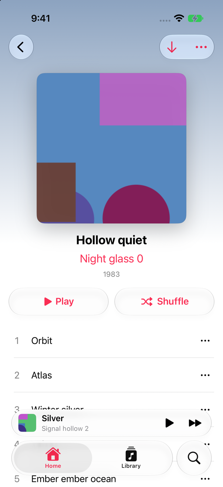
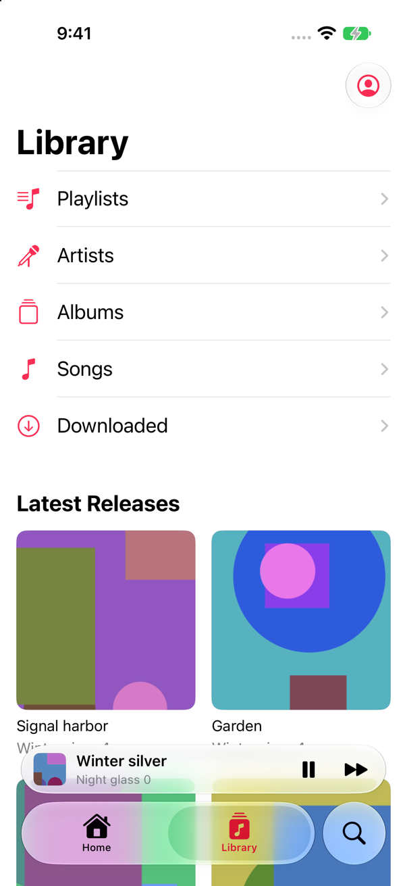
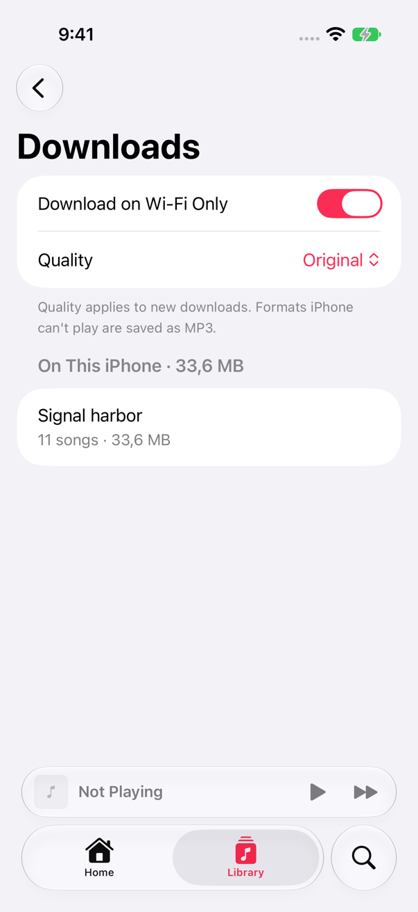

# lodesong on iPhone

A native SwiftUI app (`apps/ios`, iOS 26 or newer) that talks to your lodesong server: your library stored on the
phone, playback with the screen locked, and playlists you can keep downloaded.

| Home | Album | Now playing | Library |
|---|---|---|---|
|  |  |  |  |

Installing it is free. You don't need the paid Apple developer account (99 USD a year) and there is nothing to set up
in the App Store: a tool called [SideStore](https://sidestore.io) signs the app with your own free Apple ID.

## What you need

- an iPhone on iOS 26 or newer
- a computer (Mac, Windows or Linux) with a cable, for the first setup
- a free Apple ID. The setup tool is third party and asks for the password, so a spare Apple ID is a good idea.
  **Use that same Apple ID every time** you install, refresh or recover: another one installs a second, empty copy
- on Windows, iTunes; on Linux, `usbmuxd`
- Wi-Fi on the phone while installing and refreshing
- a running lodesong your phone can reach, ideally on HTTPS ([self-hosting](self-hosting.md))

## Install, step by step

**The native app is in releases from 2.0.0.**

You use three apps: **iloader** on the computer (installs SideStore), and **LocalDevVPN** and **SideStore** on the
iPhone. The steps follow [SideStore's own guide](https://docs.sidestore.io/docs/installation/install).

### 1. Prepare the iPhone

Get **LocalDevVPN** from the App Store, open it, tap **Connect** and allow the VPN. SideStore needs it connected every
time it signs in, installs or refreshes.

### 2. Put SideStore on the iPhone

1. On the computer, install [iloader](https://github.com/nab138/iloader/releases/latest). On a Mac without an
   administrator account, drag it into the `Applications` folder inside your home folder.
2. Plug the phone in, unlock it, tap **Trust** and enter your passcode.
3. In iloader, sign in with the Apple ID, pick the phone and choose **Install SideStore (Stable)**.
4. In iloader, open **Manage Pairing File** and press **Place** next to SideStore.

### 3. Allow it to run

1. Settings → General → **VPN & Device Management** → your Apple ID → **Trust**, then **Allow & Restart** if it asks.
2. Settings → Privacy & Security → **Developer Mode** → on. The phone restarts.

### 4. Sign in to SideStore

1. Connect LocalDevVPN, open SideStore and sign in with the same Apple ID. If you see `ADI native error (-45063)`,
   follow [the fix below](#sign-in-fails-with-adi-native-error--45063).
2. Under **My Apps**, tap the **7 DAYS** counter once and let it finish.

### 5. Add lodesong

Either way works; the source is the one that shows updates.

- **From the source:** SideStore → **Sources** → **+**, paste this, then install lodesong from it:

  ```
  https://github.com/FindMalek/lodesong/releases/latest/download/altstore.json
  ```

- **From a file:** get `lodesong-ios.ipa` onto the phone (AirDrop it and save it to **Files**), then SideStore →
  **My Apps** → **+** and pick it. For a build that isn't released yet, download `lodesong-ios` from a `main` run of
  the [iOS workflow](../.github/workflows/ios.yml), signed in to GitHub, and unzip it.

### 6. Sign in to lodesong

Enter your **lodesong** address (not Navidrome's) and your Navidrome account, not your Apple ID.


A free Apple ID allows **3** sideloaded apps at a time, and SideStore is one of them.

## Updates

A new release shows as **Update** next to lodesong in SideStore. Tap it. Updates aren't silent, and they come from
published releases, not from every change in the code.

To get them, add the source from step 5, even if you first installed from a file. Check that SideStore offers to
update the lodesong you have; if it offers a second copy, don't install it. Moving from a file install to the source
has not been checked on a phone yet.

Install over the old app: don't delete lodesong first, or its downloads and sign in go with it.

### Beta builds

To get an update after every iOS change merged to `main`, add this source in SideStore and install lodesong from it,
over the app you have (same app, so downloads and sign in should stay):

```
https://raw.githubusercontent.com/FindMalek/lodesong/ios-beta/altstore.json
```

- A beta is the next patch as a prerelease, like `2.0.1-beta.57`: newer than release 2.0.0, older than
  2.0.1. After a release, betas move past it with the next iOS change.
- It comes from the `ios-beta` branch: no tags or releases, one commit that each build replaces
  (`apps/ios/altstore/beta.sh`). Don't create a tag with that name.
- A new build can take about 5 minutes to appear (GitHub caches raw files).

Add the release source or the beta source, not both.

## The 7 days

Apple signs free apps for 7 days. **Refreshing** signs the app again for another 7. It is not a reinstall you do by
hand: you delete nothing.

If the 7 days run out:

- the icon stays on the home screen, but the app **won't open**
- your server, music and play history are not affected
- refreshing or installing over it brings it back. Data on the phone should still be there; we haven't verified that on
  a real device yet. **Deleting the app does remove it**
- plays and downloads made before expiry stay on the phone until it opens again

SideStore expires the same way. If **SideStore** has expired it can't refresh anything, including itself: plug into the
computer and repeat step 2 with iloader. Don't delete lodesong; refresh it or install over it afterwards.

If refresh starts failing after an iPhone update or reset, the pairing file is probably stale: press **Place** again (step 2).

### Refresh without thinking about it

SideStore tries to refresh in the background on its own. iOS doesn't promise when that runs, so add a daily Shortcut.
Open lodesong once first, so its action exists. In **Shortcuts**, tap **+** and add these in order with the search box:

| # | Search for | Set it to |
|---|---|---|
| 1 | LocalDevVPN's action | tap the first word and choose **Enable**, not Toggle. Leave **Use App Settings** on |
| 2 | **Wait** | 3 seconds |
| 3 | **URL** | `sidestore://` |
| 4 | **Open URLs** | it takes the URL from step 3 |
| 5 | **Wait** | 3 seconds |
| 6 | **Refresh All Apps** (SideStore) | |
| 7 | **Mark lodesong as Refreshed** (lodesong) | |
| 8 | LocalDevVPN's action again | **Disable** |
| 9 | Tailscale's connect action | only if you reach your server over Tailscale: iOS runs one VPN at a time |

Name it `refresh apps` and press play. Choose **Always Allow** when asked, then check that SideStore shows 7 days.

Then: **Automation** tab → **+** → **Time of Day** → a time when the phone is usually on Wi-Fi and unlocked → **Daily**
→ **Run Immediately** → **Next** → `refresh apps`. Keep **Notify When Run** on for the first week.

Open SideStore now and then and check the days left, and refresh by hand before a trip. If the shortcut fails on
iOS 27 while a manual refresh works, see [this SideStore issue](https://github.com/SideStore/SideStore/issues/1596).

### Expiry warnings

Settings → About shows the days left, and the app notifies you 2 days and 1 day before. It reads the date from the
signing profile inside the app, which an install or update replaces. A SideStore **refresh does not**: it adds a new
profile to the phone and leaves the app as it was. So the app has to be told, with the shortcut action above or
**I Refreshed Today** on the same screen; either counts 7 more days from that moment. If you refresh without telling
it, you get warnings you can ignore, and once the old date has passed it shows the days left as unknown.

iOS asks whether lodesong may notify you the first time you download something, or from the button on that screen.
Builds that aren't signed (the simulator) show none of this.

A server can't do the refresh for you (a cron job on your homelab has no way to sign or install on the phone).

## When something goes wrong

### Sign in fails with ADI native error (-45063)

A [known SideStore bug](https://github.com/SideStore/SideStore/issues/1765), not your password. Don't keep retrying.
This workaround comes from that issue:

1. SideStore → Settings → **User Customizations** → turn **On-Device Anisette** off.
2. Swipe SideStore away and open it again.
3. Settings (the main screen) → **Anisette Servers** → `https://mac-ani.jkcoxson.com`. This server is run by someone
   else, one more reason for a spare Apple ID.
4. **User Customizations** → **Anisette Client Configuration** → **Remote Server Sync** → **Fetch** → **Save as
   Overrides**. Don't tap **Reset to Defaults** on that screen.
5. **User Customizations** → **Reset adi.pb**, keep headers on → **Reset & Sign Out**.
6. Swipe it away, reopen, connect LocalDevVPN and sign in. If SideStore offers to revoke certificates, decline.

## Other ways

- **No app:** open your lodesong in Safari → Share → **Add to Home Screen**. Never expires, but the silent switch can
  mute it and iOS may stop audio on a long screen lock.
- **Xcode** (Mac): `brew install xcodegen`, then `cd apps/ios && xcodegen generate && open Lodesong.xcodeproj`. Under
  Signing & Capabilities pick your *Personal Team* and a bundle identifier of your own, then Run. Repeat every 7 days.
- **[Sideloadly](https://sideloadly.io)** or **[AltStore](https://altstore.io)** also install the `.ipa`. AltStore
  refreshes only while your computer is on the same Wi-Fi.

## Using it

1. Sign in with your server's address and your Navidrome account. Away from home the address must be reachable from
   outside: a domain with HTTPS, a tunnel, or Tailscale on the phone.
2. The library syncs when you open the app. Pull down in the library to sync by hand.
3. Download an album or playlist from its page. A downloaded playlist follows its additions, removals and order the
   next time the app syncs. Lyrics and covers are saved with downloaded songs.
4. Plays count offline too. They are kept on the phone with their own time and sent to lodesong's history and
   Navidrome the next time the app is open and reaches the server.
5. The quote button in now playing opens the [lyrics](lyrics.md): tap a line to jump there, the timer button shifts
   them. When your files carry lyrics in more than one language the translation shows under each line, and the button
   beside the timer picks the language or turns it off. **Settings → Appearance → Lyrics Source** is what the server
   found (your files, then LRCLIB) or your files only. [Search](search.md) finds songs by their words too, and takes `artist:`, `album:`, `genre:`, `year:`,
   `format:` and `lyrics:`. Offline it searches the lyrics saved on the phone.

   lodesong notifies you when a sync finds new tracks in a downloaded playlist; **Notify About New Tracks** under
   Storage → Downloads turns that off. With the app closed this waits for iOS to wake it, which it may not do for hours.



## Shortcuts, Spotlight and links

All of these work with a free Apple ID.

- **Shortcuts**: Play Playlist, Play Song, Like Current Song, Unlike Current Song and Mark lodesong as Refreshed. All
  but the last are also listed under lodesong in Shortcuts without setting anything up. While another device plays,
  they act on that device. Offline only downloaded songs play, and a like is sent later. Signed out they say so.
- **Spotlight**: your playlists are indexed, and signing out removes them.
- **Links**: `lodesong://album/<id>` and `lodesong://playlist/<id>` open that page, with the ids the web player has
  in its addresses. A link only opens a page, and does nothing while signed out.

Not possible with free signing: "play something on lodesong" through Siri's own music commands (needs the Siri
entitlement) and `https` links that open the app (needs Associated Domains). CarPlay is
[#682](https://github.com/FindMalek/lodesong/issues/682).

## Offline and downloads

- **Offline Mode** (Settings): nothing is sent to the server. Only songs on the phone play, plays are counted and sent
  later, downloads wait.
- Settings → Storage → Downloads has **Download All Playlists** (new ones too; a playlist you remove stays removed),
  the queue of what is still to come, and the list of downloaded songs.
- **Cache Songs Ahead** (Playback) fetches the next 1 to 10 songs in full. Temporary, separate from downloads.

## Two server addresses

Settings → **Server Addresses** takes a second address of the same server. It needs your password once, and
downloads, covers and plays are shared between the two.

- Both `https`: the main one is tried first on every sync and network change, the second when it doesn't answer.
- Either one plain `http`: nothing switches by itself. The `https` one is used until you pick the other under **Use**.
  An `http` address is trusted on whatever network you are on, so whoever holds it there receives your session:
  pick it only on a network you trust, and prefer HTTPS for both.

A second address that stops accepting your sign in is dropped, not asked for your password: remove it and add it again.

## Now playing and the queue

- Two styles. **Arpeggi style** is the default: names in the middle, shuffle and repeat beside the controls, no volume
  slider. It was designed from Arpeggi's public App Store picture and release notes, not copied from the app, so
  expect differences. **Apple Music style** has the names on the left and a volume slider.
- **Settings → Player** (also from "..." on now playing): cover shrinking when paused, mesh or mono background,
  scrolling titles, the cover swipe (changes song, can be reversed), the swipe on the names and controls (steps 5 to
  30 seconds, 10 by default), the mini player swipe, which buttons sit at the bottom and in what order (the sleep timer
  is off at first; "..." has lyrics, queue and devices
  too, and the devices button stays while another device plays), and previous and next or skip for the lock screen, headphones and car.
- "..." also has the song's actions, sleep timer, playback, streaming, cache and scrobbling settings.
- The queue: **infinite play** adds similar songs when five or fewer are left (not with repeat on), **history** lists
  the last 200 songs heard on this phone whatever queue they were in, and its menu has the sleep timer (minutes, end of
  song, album or queue), save as playlist and clear.
- **Start Radio** on a song or an artist plays songs like it, without the ones you banned from radio on the web.

## Settings

The app works without opening them.

- **Playback**: streaming quality on Wi-Fi and on cellular, ReplayGain, speed, infinite play, keep shuffle on, sync
  the queue across devices, report playback and when a play counts (the minimum time can be turned off), cache songs
  ahead, confirm before replacing the queue.
- **Player**: see [now playing](#now-playing-and-the-queue).
- **Appearance**: light, dark or system, app tint (red, blue or your own colour), tab bar shrinking, lyrics text size,
  what a swipe on a song does, order of the Home and Library sections.
- **Storage**: downloads and the space they take, new track notifications, artwork cache.
- **Logs**: recent syncs and failures, with the server address hidden unless you turn that off.
- **About**: version and signing days left.

## Alerts through ntfy (not built)

Push isn't available on free signing, so alerts that don't wait for iOS to wake the app would go through
[ntfy](https://ntfy.sh) ([#680](https://github.com/FindMalek/lodesong/issues/680)). It would take:

- server settings for the ntfy address and an optional access token, and a long random topic for each account (anyone
  who knows a topic can read it)
- a job on the server that reads each account's playlists every few minutes with the Subsonic token of a live sign in,
  remembers their song ids and posts the playlist name and number of new tracks. The first pass only records. Accounts
  with no live sign in get nothing
- a choice of which playlists count: the server doesn't know what is downloaded on a phone
- a `lodesong://` URL scheme in the app, sent as the message's `Click` link, so tapping opens the app and it syncs
- the ntfy app on the iPhone, subscribed to the topic. A self-hosted ntfy also needs `upstream-base-url` set to
  `https://ntfy.sh` for iOS to deliver at once
- turning off the app's own notification, or both arrive

## What to check on your phone

It has had a first try on an iPhone 16 Pro. [The device checklist](ios-device-checklist.md) lists what is still to check.

## How it works

- The session is the same cookie sign in the web player uses (`/auth/login`), then Subsonic under `/rest`.
- Screens read from a SQLite database on the phone. A failed sync never empties it.
- Playback uses `AVQueuePlayer`. What streams as is and what the server transcodes: [audio formats](ios-audio.md).
- Downloads use a background `URLSession`; every file is checked before it counts.

## Not there yet

Search filters `is:`, `bpm:`, `energy:` and `mood:`, singer parts in lyrics (the server doesn't send them), CarPlay
browsing. See the
[iOS issues](https://github.com/FindMalek/lodesong/issues?q=is%3Aopen+label%3Aios).
