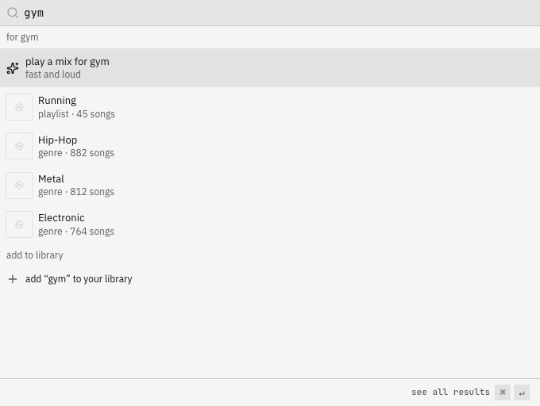

# Search

`⌘K` (or `/`) opens search from anywhere; `↵` on a result plays it, `⌘↵` opens the full results page.

lodesong searches its own index on the server (SQLite FTS5 over your whole library and its lyrics), not
Navidrome's search, so it forgives what Navidrome's doesn't:

| you type | it finds |
|---|---|
| `radiohed` | Radiohead (typos) |
| `okcomputer` | OK Computer (missing spaces) |
| `beyonce`, `sigur ros` | Beyoncé, Sigur Rós (accents) |
| `acdc` | AC/DC (punctuation) |
| `daft punk - one more time`, `one more time by daft punk` | that song, with the artist and title split for you |
| `i'm counting the stars` | the song with that line, and playing it **starts at that line** |

Results are grouped (top result, songs, albums, artists, lyrics) and ranked: exact title or artist first, then
prefix, word and fuzzy matches. Within those, songs you like and play often come first. A lyrics match never
outranks a song whose title matches.

## Filters

Add these to any search; each shows as a chip you can remove.

| filter | example |
|---|---|
| `artist:` | `artist:"massive attack"` |
| `album:` | `album:mezzanine` |
| `genre:` | `genre:trip-hop` |
| `year:` | `year:1998`, `year:1990..1999`, `year:..1980` |
| `format:` | `format:flac` |
| `is:liked`, `is:unplayed` | `is:liked year:2020..` |
| `bpm:`, `energy:`, `mood:` | `bpm:120..130`, `energy:high` (`low`, `mid`, `high` or `0.6..`), `mood:chill` (`upbeat`, `chill`, `intense`, `sad`). Songs only, and only once [AudioMuse-AI](configuration.md) (`AUDIOMUSE_URL`) has analysed them |
| `lyrics:` | `lyrics: counting the stars` (only lyrics; the rest of the text is the phrase) |

Filters alone work too: `genre:jazz year:1950..1965` lists the most played matches.

## Moods

Type a mood in `⌘K` (`gym`, `workout`, `melancholy`, `rainy`, `focus`, `late night`, `chill`, `party`, `happy`, a few
french words too) and a "for gym" group comes first: a mix that plays right away, your playlists whose names fit, and
the genres that fit. The mix uses the `bpm:` / `energy:` / `mood:` filters above when AudioMuse-AI has analysed your
songs (gym is high energy and 110+ bpm), and plays songs from the matching genres when it hasn't. The words live in
`packages/shared/src/vibes.ts`.

## Search inside a list

`⌘F` on an album, playlist, liked songs, the queue or any song list filters that list in place.

## The index

The server builds it as one account (`INDEX_USER`/`INDEX_PASSWORD`, else the admin who signed in most recently),
syncs after every Navidrome scan and once a day, and only ever returns what the person searching may see (music
folders per user). Admins: user menu → library index shows the counts and a "rebuild now" button. Lyrics become
searchable as they're fetched ([lyrics](lyrics.md)); search says how many are indexed so far.
